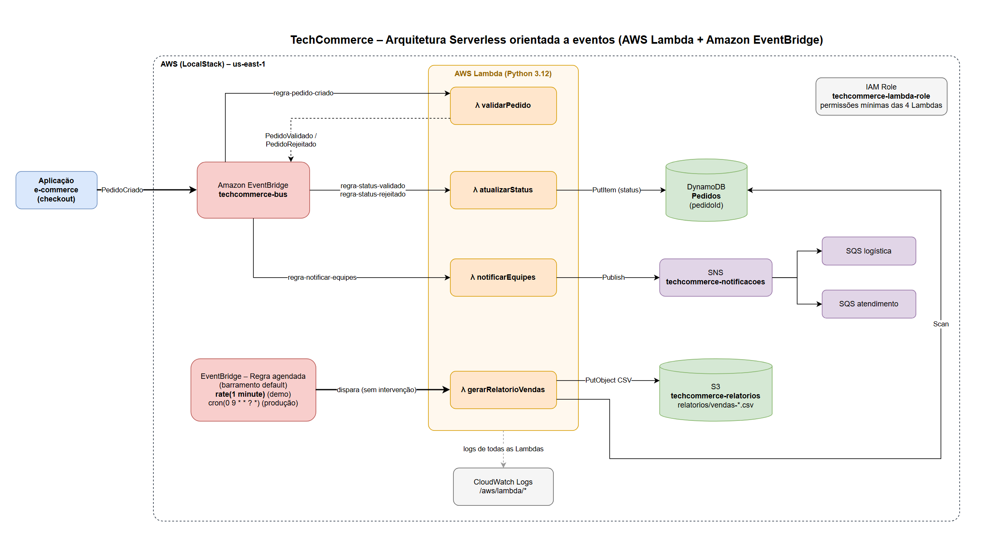
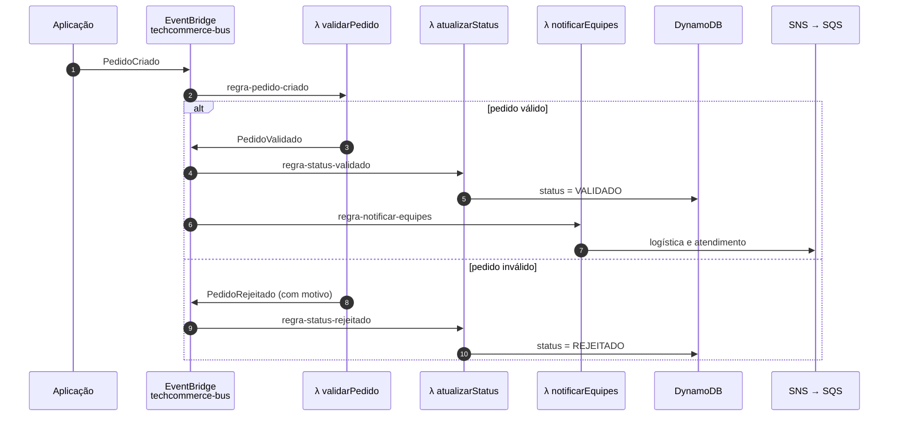
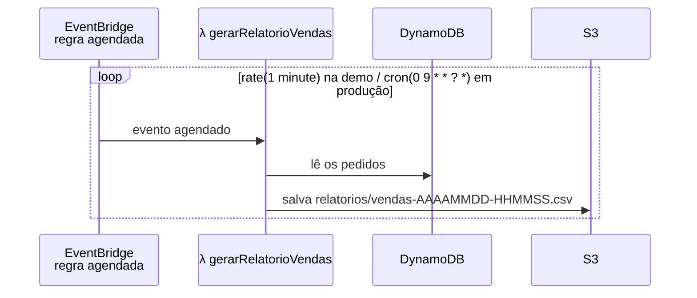

# TechCommerce – Arquitetura Serverless orientada a eventos

Projeto da disciplina **Cloud Computing for Software Development** (UniFECAF).

Proposta e demonstração de uma arquitetura **serverless orientada a eventos** com **AWS Lambda** e
**Amazon EventBridge** para automatizar processos de um e-commerce que antes eram executados
manualmente em servidores dedicados.



## Contexto

A **TechCommerce** é um e-commerce em crescimento que executava manualmente, em servidores dedicados:

- a validação de pedidos;
- a atualização de status;
- a notificação das equipes de logística e atendimento;
- a geração do relatório de vendas.

Esse modelo gera custo fixo com servidores ociosos, atrasos e erros por depender de pessoas, além de
dificultar o crescimento em picos de demanda.

## Solução

Cada etapa virou uma **função Lambda independente**, acionada automaticamente pelo **EventBridge**:

- **por eventos da aplicação**: a criação de um pedido dispara validação → atualização de status → notificação;
- **por agendamento**: uma regra agendada do EventBridge gera o relatório de vendas periodicamente.

As Lambdas não chamam umas às outras: elas se comunicam somente por eventos. Por isso as etapas ficam
desacopladas, e um novo consumidor (por exemplo, um antifraude) pode ser adicionado criando apenas uma nova regra.

### Fluxo por evento



### Fluxo agendado



### Eventos

| detail-type       | Publicado por   | Consumido por                     |
|-------------------|-----------------|-----------------------------------|
| `PedidoCriado`    | Aplicação       | validarPedido                     |
| `PedidoValidado`  | validarPedido   | atualizarStatus, notificarEquipes |
| `PedidoRejeitado` | validarPedido   | atualizarStatus                   |
| *(agendamento)*   | EventBridge     | gerarRelatorioVendas              |

Todos os eventos de negócio usam `source = techcommerce.pedidos`.

## Componentes

| Serviço | Recurso | Função |
|---|---|---|
| EventBridge | `techcommerce-bus` | Barramento dos eventos de negócio |
| EventBridge | `regra-relatorio-vendas` | Regra agendada do relatório (barramento `default`) |
| Lambda | `validarPedido` | Valida pedidoId, cliente, valor > 0 e itens; publica `PedidoValidado` ou `PedidoRejeitado` |
| Lambda | `atualizarStatus` | Grava o pedido e o status no DynamoDB |
| Lambda | `notificarEquipes` | Publica a notificação no SNS |
| Lambda | `gerarRelatorioVendas` | Lê o DynamoDB, gera CSV e salva no S3 |
| DynamoDB | `Pedidos` (chave `pedidoId`) | Status dos pedidos |
| S3 | `techcommerce-relatorios` | Relatórios CSV |
| SNS | `techcommerce-notificacoes` | Distribuição das notificações (fan-out) |
| SQS | `techcommerce-logistica`, `techcommerce-atendimento` | Representam as equipes assinantes |
| IAM | `techcommerce-lambda-role` | Permissões mínimas das 4 Lambdas |
| CloudWatch Logs | `/aws/lambda/*` | Logs de execução |

Todas as Lambdas são escritas em **Python 3.12**.

## Ambiente

A AWS é emulada localmente com o **[LocalStack](https://www.localstack.cloud/)** em Docker. O código e os
comandos são os mesmos de uma conta AWS real; muda só o endpoint (`http://localhost:4566`).

## Estrutura

```
├── docker-compose.yml          LocalStack (container techcommerce-localstack)
├── deploy.ps1                  cria/atualiza toda a infraestrutura (idempotente)
├── demo.ps1                    publica eventos de exemplo e exibe os resultados
├── destroy.ps1                 remove somente os recursos do projeto
├── scripts/common.ps1          configurações compartilhadas e função awslocal
├── lambdas/
│   ├── validarPedido/lambda_function.py
│   ├── atualizarStatus/lambda_function.py
│   ├── notificarEquipes/lambda_function.py
│   └── gerarRelatorioVendas/lambda_function.py
├── events/
│   ├── pedido-valido.json      pedido 1001 (válido)
│   └── pedido-invalido.json    pedido 1002 (valor 0 e sem itens)
└── docs/                       diagramas da arquitetura (.md, .drawio, .png)
```

## Como executar

**Pré-requisitos:** Windows com PowerShell, Docker Desktop, AWS CLI v2, Python 3.12 e um auth token do
LocalStack na variável de ambiente `LOCALSTACK_AUTH_TOKEN`.

```powershell
Set-ExecutionPolicy -Scope Process Bypass   # se o PowerShell bloquear os scripts

docker compose up -d     # sobe o LocalStack
.\deploy.ps1             # cria a infraestrutura
.\demo.ps1               # publica os eventos e mostra os resultados
.\destroy.ps1            # remove os recursos do projeto
docker compose down      # para o LocalStack
```

Se a porta 4566 estiver ocupada, defina outra antes de subir: `$env:LOCALSTACK_PORT=4567`. Os scripts
leem a mesma variável.

### O que a demonstração mostra

1. A aplicação publica dois eventos `PedidoCriado`: o pedido `1001` (válido) e o `1002` (valor 0 e sem itens).
2. No DynamoDB, o `1001` fica **VALIDADO** e o `1002` fica **REJEITADO**, com o motivo.
3. As filas de logística e atendimento recebem a notificação apenas do pedido válido.
4. A regra agendada gera um CSV no S3 com o total de vendas validadas.
5. Os logs do CloudWatch mostram a cadeia de execução entre as Lambdas.

## Decisões de projeto

- **Barramento customizado** para os eventos de negócio, isolando-os dos eventos da conta.
- **Regra agendada no barramento `default`**, como exige a AWS. Usa `rate(1 minute)` na demo; a
  configuração de produção `cron(0 9 * * ? *)` fica comentada no `deploy.ps1`.
- **Deploy idempotente**: cada recurso é verificado antes de ser criado. No LocalStack, repetir
  `put-targets` numa regra agendada duplica os disparos; por isso o alvo só é registrado se ainda não existir.
- **Permissões mínimas**: a role das Lambdas libera apenas as ações usadas em cada recurso.

## Próximos passos

- Filas de erro (DLQ) e políticas de retry nas regras.
- Alarmes no CloudWatch para erros e duração.
- AWS Step Functions para fluxos mais longos (pagamento, expedição).
- Deploy em uma conta AWS real com AWS SAM, CDK ou Terraform.

---

Felipe Bergamin Dantas · RA 103538 · UniFECAF
