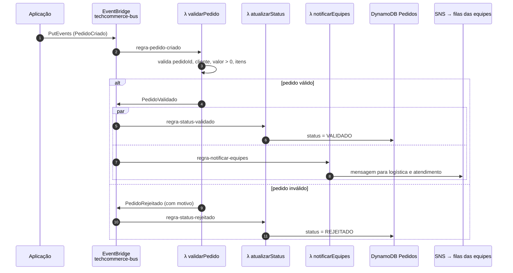
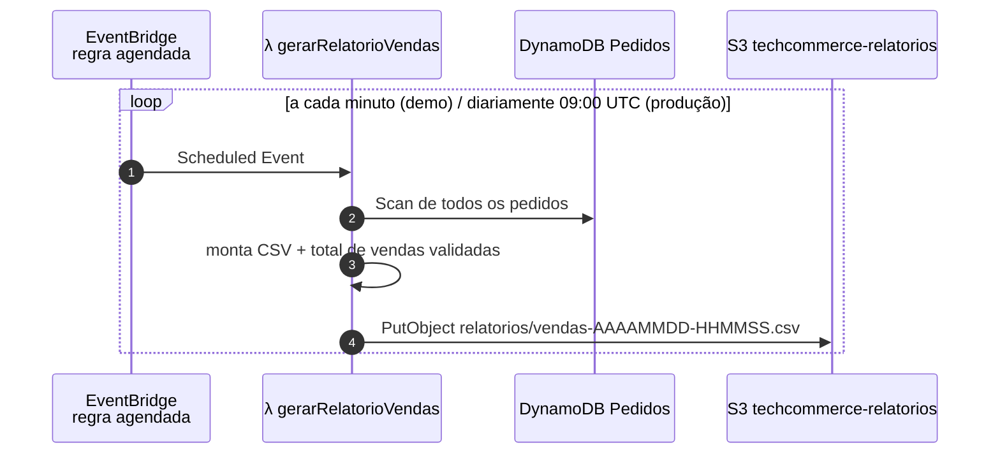

# Arquitetura Serverless orientada a eventos – TechCommerce

Todos os componentes são serviços gerenciados da AWS (emulados localmente pelo LocalStack).
Não há servidor dedicado: o código só executa quando um **evento** ou um **agendamento** acontece.

## Visão geral

```drawio
<mxfile>
  <diagram id="wvvAgGC7yt5rmzw51LHR" name="Page-1">
    <mxGraphModel dx="1820" dy="1248" grid="1" gridSize="10" guides="1" tooltips="0" connect="1" arrows="1" fold="1" page="1" pageScale="1" pageWidth="850" pageHeight="1100" math="0" shadow="0">
      <root>
        <mxCell id="KM9smV5a_sdy3V8UoBAd-0" />
        <mxCell id="KM9smV5a_sdy3V8UoBAd-1" parent="KM9smV5a_sdy3V8UoBAd-0" />
        <UserObject label="" mermaidData="{&#xa;  &quot;data&quot;: &quot;flowchart LR\n    APP[\&quot;Aplicação de e-commerce&lt;br/&gt;(checkout)\&quot;] -- \&quot;PedidoCriado\&quot; --&gt; BUS\n\n    subgraph EB[\&quot;Amazon EventBridge\&quot;]\n        BUS([\&quot;techcommerce-bus&lt;br/&gt;(event bus customizado)\&quot;])\n        SCH([\&quot;Regra agendada&lt;br/&gt;rate(1 minute) / cron(0 9 * * ? *)\&quot;])\n    end\n\n    BUS -- \&quot;regra-pedido-criado\&quot; --&gt; L1[\&quot;λ validarPedido\&quot;]\n    L1 -- \&quot;PedidoValidado / PedidoRejeitado\&quot; --&gt; BUS\n    BUS -- \&quot;regra-status-validado&lt;br/&gt;regra-status-rejeitado\&quot; --&gt; L2[\&quot;λ atualizarStatus\&quot;]\n    BUS -- \&quot;regra-notificar-equipes\&quot; --&gt; L3[\&quot;λ notificarEquipes\&quot;]\n    SCH --&gt; L4[\&quot;λ gerarRelatorioVendas\&quot;]\n\n    L2 --&gt; DDB[(\&quot;DynamoDB&lt;br/&gt;Pedidos\&quot;)]\n    L3 --&gt; SNS{{\&quot;SNS&lt;br/&gt;techcommerce-notificacoes\&quot;}}\n    SNS --&gt; Q1[\&quot;SQS techcommerce-logistica\&quot;]\n    SNS --&gt; Q2[\&quot;SQS techcommerce-atendimento\&quot;]\n    L4 -- \&quot;scan\&quot; --&gt; DDB\n    L4 -- \&quot;CSV\&quot; --&gt; S3[(\&quot;S3&lt;br/&gt;techcommerce-relatorios\&quot;)]\n\n    L1 &amp; L2 &amp; L3 &amp; L4 -.-&gt; CW[\&quot;CloudWatch Logs\&quot;]&quot;,&#xa;  &quot;config&quot;: null&#xa;}" id="neVwadlwZLFAnQuyxoAD-0">
          <mxCell connectable="0" parent="KM9smV5a_sdy3V8UoBAd-1" style="group;transparentBounds=1;editIcon=1;lockedGroup=0;groupPadding=10;" vertex="1">
            <mxGeometry as="geometry" />
          </mxCell>
        </UserObject>
        <UserObject label="Amazon EventBridge" mermaidId="n:EB" mermaidBaseStyle="html=1;whiteSpace=wrap;strokeWidth=1;verticalAlign=top;fillColor=light-dark(#ffffde,#1f2020);strokeColor=light-dark(#aaaa33,#cccccc);fontColor=light-dark(#333333,#cccccc);fontFamily=Trebuchet MS,Verdana,Arial,sans-serif;fontSize=16;" mermaidBaseValue="Amazon EventBridge" id="KM9smV5a_sdy3V8UoBAd-2">
          <mxCell parent="neVwadlwZLFAnQuyxoAD-0" style="html=1;whiteSpace=wrap;strokeWidth=1;verticalAlign=top;fillColor=light-dark(#ffffde,#1f2020);strokeColor=light-dark(#aaaa33,#cccccc);fontColor=light-dark(#333333,#cccccc);fontFamily=Trebuchet MS,Verdana,Arial,sans-serif;fontSize=16;" vertex="1">
            <mxGeometry height="404" width="316" x="389" y="166" as="geometry" />
          </mxCell>
        </UserObject>
        <UserObject label="techcommerce-bus&#xa;(event bus customizado)" mermaidId="n:BUS" mermaidBaseStyle="html=1;rounded=1;whiteSpace=wrap;arcSize=50;strokeWidth=1;fillColor=light-dark(#ECECFF,#1f2020);strokeColor=light-dark(#9370DB,#cccccc);fontColor=light-dark(#333333,#cccccc);fontFamily=Trebuchet MS,Verdana,Arial,sans-serif;fontSize=16;" mermaidBaseValue="techcommerce-bus&#xa;(event bus customizado)" id="KM9smV5a_sdy3V8UoBAd-3">
          <mxCell parent="KM9smV5a_sdy3V8UoBAd-2" style="html=1;rounded=1;whiteSpace=wrap;arcSize=50;strokeWidth=1;fillColor=light-dark(#ECECFF,#1f2020);strokeColor=light-dark(#9370DB,#cccccc);fontColor=light-dark(#333333,#cccccc);fontFamily=Trebuchet MS,Verdana,Arial,sans-serif;fontSize=16;" vertex="1">
            <mxGeometry height="63" width="212" x="52" y="45" as="geometry" />
          </mxCell>
        </UserObject>
        <UserObject label="Regra agendada&#xa;rate(1 minute) / cron(0 9 ? *)" mermaidId="n:SCH" mermaidBaseStyle="html=1;rounded=1;whiteSpace=wrap;arcSize=50;strokeWidth=1;fillColor=light-dark(#ECECFF,#1f2020);strokeColor=light-dark(#9370DB,#cccccc);fontColor=light-dark(#333333,#cccccc);fontFamily=Trebuchet MS,Verdana,Arial,sans-serif;fontSize=16;" mermaidBaseValue="Regra agendada&#xa;rate(1 minute) / cron(0 9 ? *)" id="KM9smV5a_sdy3V8UoBAd-4">
          <mxCell parent="KM9smV5a_sdy3V8UoBAd-2" style="html=1;rounded=1;whiteSpace=wrap;arcSize=50;strokeWidth=1;fillColor=light-dark(#ECECFF,#1f2020);strokeColor=light-dark(#9370DB,#cccccc);fontColor=light-dark(#333333,#cccccc);fontFamily=Trebuchet MS,Verdana,Arial,sans-serif;fontSize=16;" vertex="1">
            <mxGeometry height="63" width="246" x="35" y="316" as="geometry" />
          </mxCell>
        </UserObject>
        <UserObject label="Aplicação de e-commerce&#xa;(checkout)" mermaidId="n:APP" mermaidBaseStyle="html=1;whiteSpace=wrap;strokeWidth=1;fillColor=light-dark(#ECECFF,#1f2020);strokeColor=light-dark(#9370DB,#cccccc);fontColor=light-dark(#333333,#cccccc);fontFamily=Trebuchet MS,Verdana,Arial,sans-serif;fontSize=16;" mermaidBaseValue="Aplicação de e-commerce&#xa;(checkout)" id="KM9smV5a_sdy3V8UoBAd-5">
          <mxCell parent="neVwadlwZLFAnQuyxoAD-0" style="html=1;whiteSpace=wrap;strokeWidth=1;fillColor=light-dark(#ECECFF,#1f2020);strokeColor=light-dark(#9370DB,#cccccc);fontColor=light-dark(#333333,#cccccc);fontFamily=Trebuchet MS,Verdana,Arial,sans-serif;fontSize=16;" vertex="1">
            <mxGeometry height="73" width="245" x="10" y="206" as="geometry" />
          </mxCell>
        </UserObject>
        <UserObject label="λ validarPedido" mermaidId="n:L1" mermaidBaseStyle="html=1;whiteSpace=wrap;strokeWidth=1;fillColor=light-dark(#ECECFF,#1f2020);strokeColor=light-dark(#9370DB,#cccccc);fontColor=light-dark(#333333,#cccccc);fontFamily=Trebuchet MS,Verdana,Arial,sans-serif;fontSize=16;" mermaidBaseValue="λ validarPedido" id="KM9smV5a_sdy3V8UoBAd-6">
          <mxCell parent="neVwadlwZLFAnQuyxoAD-0" style="html=1;whiteSpace=wrap;strokeWidth=1;fillColor=light-dark(#ECECFF,#1f2020);strokeColor=light-dark(#9370DB,#cccccc);fontColor=light-dark(#333333,#cccccc);fontFamily=Trebuchet MS,Verdana,Arial,sans-serif;fontSize=16;" vertex="1">
            <mxGeometry height="54" width="170" x="1015" y="218" as="geometry" />
          </mxCell>
        </UserObject>
        <UserObject label="λ atualizarStatus" mermaidId="n:L2" mermaidBaseStyle="html=1;whiteSpace=wrap;strokeWidth=1;fillColor=light-dark(#ECECFF,#1f2020);strokeColor=light-dark(#9370DB,#cccccc);fontColor=light-dark(#333333,#cccccc);fontFamily=Trebuchet MS,Verdana,Arial,sans-serif;fontSize=16;" mermaidBaseValue="λ atualizarStatus" id="KM9smV5a_sdy3V8UoBAd-7">
          <mxCell parent="neVwadlwZLFAnQuyxoAD-0" style="html=1;whiteSpace=wrap;strokeWidth=1;fillColor=light-dark(#ECECFF,#1f2020);strokeColor=light-dark(#9370DB,#cccccc);fontColor=light-dark(#333333,#cccccc);fontFamily=Trebuchet MS,Verdana,Arial,sans-serif;fontSize=16;" vertex="1">
            <mxGeometry height="54" width="181" x="1010" y="339" as="geometry" />
          </mxCell>
        </UserObject>
        <UserObject label="λ notificarEquipes" mermaidId="n:L3" mermaidBaseStyle="html=1;whiteSpace=wrap;strokeWidth=1;fillColor=light-dark(#ECECFF,#1f2020);strokeColor=light-dark(#9370DB,#cccccc);fontColor=light-dark(#333333,#cccccc);fontFamily=Trebuchet MS,Verdana,Arial,sans-serif;fontSize=16;" mermaidBaseValue="λ notificarEquipes" id="KM9smV5a_sdy3V8UoBAd-8">
          <mxCell parent="neVwadlwZLFAnQuyxoAD-0" style="html=1;whiteSpace=wrap;strokeWidth=1;fillColor=light-dark(#ECECFF,#1f2020);strokeColor=light-dark(#9370DB,#cccccc);fontColor=light-dark(#333333,#cccccc);fontFamily=Trebuchet MS,Verdana,Arial,sans-serif;fontSize=16;" vertex="1">
            <mxGeometry height="54" width="189" x="1006" y="114" as="geometry" />
          </mxCell>
        </UserObject>
        <UserObject label="λ gerarRelatorioVendas" mermaidId="n:L4" mermaidBaseStyle="html=1;whiteSpace=wrap;strokeWidth=1;fillColor=light-dark(#ECECFF,#1f2020);strokeColor=light-dark(#9370DB,#cccccc);fontColor=light-dark(#333333,#cccccc);fontFamily=Trebuchet MS,Verdana,Arial,sans-serif;fontSize=16;" mermaidBaseValue="λ gerarRelatorioVendas" id="KM9smV5a_sdy3V8UoBAd-9">
          <mxCell parent="neVwadlwZLFAnQuyxoAD-0" style="html=1;whiteSpace=wrap;strokeWidth=1;fillColor=light-dark(#ECECFF,#1f2020);strokeColor=light-dark(#9370DB,#cccccc);fontColor=light-dark(#333333,#cccccc);fontFamily=Trebuchet MS,Verdana,Arial,sans-serif;fontSize=16;" vertex="1">
            <mxGeometry height="54" width="225" x="988" y="486" as="geometry" />
          </mxCell>
        </UserObject>
        <UserObject label="DynamoDB&#xa;Pedidos" mermaidId="n:DDB" mermaidBaseStyle="html=1;shape=cylinder3;boundedLbl=1;backgroundOutline=1;size=10;strokeWidth=1;whiteSpace=wrap;fillColor=light-dark(#ECECFF,#1f2020);strokeColor=light-dark(#9370DB,#cccccc);fontColor=light-dark(#333333,#cccccc);fontFamily=Trebuchet MS,Verdana,Arial,sans-serif;fontSize=16;" mermaidBaseValue="DynamoDB&#xa;Pedidos" id="KM9smV5a_sdy3V8UoBAd-10">
          <mxCell parent="neVwadlwZLFAnQuyxoAD-0" style="html=1;shape=cylinder3;boundedLbl=1;backgroundOutline=1;size=10;strokeWidth=1;whiteSpace=wrap;fillColor=light-dark(#ECECFF,#1f2020);strokeColor=light-dark(#9370DB,#cccccc);fontColor=light-dark(#333333,#cccccc);fontFamily=Trebuchet MS,Verdana,Arial,sans-serif;fontSize=16;" vertex="1">
            <mxGeometry height="81" width="91" x="1366" y="368" as="geometry" />
          </mxCell>
        </UserObject>
        <UserObject label="SNS&#xa;techcommerce-notificacoes" mermaidId="n:SNS" mermaidBaseStyle="html=1;shape=hexagon;perimeter=hexagonPerimeter2;fixedSize=1;size=13.25;strokeWidth=1;whiteSpace=wrap;fillColor=light-dark(#ECECFF,#1f2020);strokeColor=light-dark(#9370DB,#cccccc);fontColor=light-dark(#333333,#cccccc);fontFamily=Trebuchet MS,Verdana,Arial,sans-serif;fontSize=16;" mermaidBaseValue="SNS&#xa;techcommerce-notificacoes" id="KM9smV5a_sdy3V8UoBAd-11">
          <mxCell parent="neVwadlwZLFAnQuyxoAD-0" style="html=1;shape=hexagon;perimeter=hexagonPerimeter2;fixedSize=1;size=13.25;strokeWidth=1;whiteSpace=wrap;fillColor=light-dark(#ECECFF,#1f2020);strokeColor=light-dark(#9370DB,#cccccc);fontColor=light-dark(#333333,#cccccc);fontFamily=Trebuchet MS,Verdana,Arial,sans-serif;fontSize=16;" vertex="1">
            <mxGeometry height="53" width="233" x="1295" y="83" as="geometry" />
          </mxCell>
        </UserObject>
        <UserObject label="SQS techcommerce-logistica" mermaidId="n:Q1" mermaidBaseStyle="html=1;whiteSpace=wrap;strokeWidth=1;fillColor=light-dark(#ECECFF,#1f2020);strokeColor=light-dark(#9370DB,#cccccc);fontColor=light-dark(#333333,#cccccc);fontFamily=Trebuchet MS,Verdana,Arial,sans-serif;fontSize=16;" mermaidBaseValue="SQS techcommerce-logistica" id="KM9smV5a_sdy3V8UoBAd-12">
          <mxCell parent="neVwadlwZLFAnQuyxoAD-0" style="html=1;whiteSpace=wrap;strokeWidth=1;fillColor=light-dark(#ECECFF,#1f2020);strokeColor=light-dark(#9370DB,#cccccc);fontColor=light-dark(#333333,#cccccc);fontFamily=Trebuchet MS,Verdana,Arial,sans-serif;fontSize=16;" vertex="1">
            <mxGeometry height="54" width="263" x="1594" y="114" as="geometry" />
          </mxCell>
        </UserObject>
        <UserObject label="SQS techcommerce-atendimento" mermaidId="n:Q2" mermaidBaseStyle="html=1;whiteSpace=wrap;strokeWidth=1;fillColor=light-dark(#ECECFF,#1f2020);strokeColor=light-dark(#9370DB,#cccccc);fontColor=light-dark(#333333,#cccccc);fontFamily=Trebuchet MS,Verdana,Arial,sans-serif;fontSize=16;" mermaidBaseValue="SQS techcommerce-atendimento" id="KM9smV5a_sdy3V8UoBAd-13">
          <mxCell parent="neVwadlwZLFAnQuyxoAD-0" style="html=1;whiteSpace=wrap;strokeWidth=1;fillColor=light-dark(#ECECFF,#1f2020);strokeColor=light-dark(#9370DB,#cccccc);fontColor=light-dark(#333333,#cccccc);fontFamily=Trebuchet MS,Verdana,Arial,sans-serif;fontSize=16;" vertex="1">
            <mxGeometry height="54" width="295" x="1578" y="10" as="geometry" />
          </mxCell>
        </UserObject>
        <UserObject label="S3&#xa;techcommerce-relatorios" mermaidId="n:S3" mermaidBaseStyle="html=1;shape=cylinder3;boundedLbl=1;backgroundOutline=1;size=10;strokeWidth=1;whiteSpace=wrap;fillColor=light-dark(#ECECFF,#1f2020);strokeColor=light-dark(#9370DB,#cccccc);fontColor=light-dark(#333333,#cccccc);fontFamily=Trebuchet MS,Verdana,Arial,sans-serif;fontSize=16;" mermaidBaseValue="S3&#xa;techcommerce-relatorios" id="KM9smV5a_sdy3V8UoBAd-14">
          <mxCell parent="neVwadlwZLFAnQuyxoAD-0" style="html=1;shape=cylinder3;boundedLbl=1;backgroundOutline=1;size=10;strokeWidth=1;whiteSpace=wrap;fillColor=light-dark(#ECECFF,#1f2020);strokeColor=light-dark(#9370DB,#cccccc);fontColor=light-dark(#333333,#cccccc);fontFamily=Trebuchet MS,Verdana,Arial,sans-serif;fontSize=16;" vertex="1">
            <mxGeometry height="81" width="196" x="1313" y="499" as="geometry" />
          </mxCell>
        </UserObject>
        <UserObject label="CloudWatch Logs" mermaidId="n:CW" mermaidBaseStyle="html=1;whiteSpace=wrap;strokeWidth=1;fillColor=light-dark(#ECECFF,#1f2020);strokeColor=light-dark(#9370DB,#cccccc);fontColor=light-dark(#333333,#cccccc);fontFamily=Trebuchet MS,Verdana,Arial,sans-serif;fontSize=16;" mermaidBaseValue="CloudWatch Logs" id="KM9smV5a_sdy3V8UoBAd-15">
          <mxCell parent="neVwadlwZLFAnQuyxoAD-0" style="html=1;whiteSpace=wrap;strokeWidth=1;fillColor=light-dark(#ECECFF,#1f2020);strokeColor=light-dark(#9370DB,#cccccc);fontColor=light-dark(#333333,#cccccc);fontFamily=Trebuchet MS,Verdana,Arial,sans-serif;fontSize=16;" vertex="1">
            <mxGeometry height="54" width="181" x="1321" y="238" as="geometry" />
          </mxCell>
        </UserObject>
        <UserObject label="PedidoCriado" mermaidId="e:APP-&gt;BUS#0" mermaidBaseStyle="curved=1;startArrow=none;endArrow=block;endSize=7;strokeColor=light-dark(#333333,#cccccc);html=1;fontSize=16;labelBackgroundColor=light-dark(#E8E8E88D,#2a2a2a8D);fontFamily=Trebuchet MS,Verdana,Arial,sans-serif;fontColor=light-dark(#333333,#cccccc);exitX=1;exitY=0.51;entryX=0;entryY=0.51;" mermaidBaseValue="PedidoCriado" id="KM9smV5a_sdy3V8UoBAd-16">
          <mxCell edge="1" parent="neVwadlwZLFAnQuyxoAD-0" source="KM9smV5a_sdy3V8UoBAd-5" style="curved=1;startArrow=none;endArrow=block;endSize=7;strokeColor=light-dark(#333333,#cccccc);html=1;fontSize=16;labelBackgroundColor=light-dark(#E8E8E88D,#2a2a2a8D);fontFamily=Trebuchet MS,Verdana,Arial,sans-serif;fontColor=light-dark(#333333,#cccccc);exitX=1;exitY=0.51;entryX=0;entryY=0.51;" target="KM9smV5a_sdy3V8UoBAd-3">
            <mxGeometry relative="1" as="geometry">
              <Array as="points" />
            </mxGeometry>
          </mxCell>
        </UserObject>
        <UserObject label="regra-pedido-criado" mermaidId="e:BUS-&gt;L1#0" mermaidBaseStyle="curved=1;startArrow=none;endArrow=block;endSize=7;strokeColor=light-dark(#333333,#cccccc);html=1;fontSize=16;labelBackgroundColor=light-dark(#E8E8E88D,#2a2a2a8D);fontFamily=Trebuchet MS,Verdana,Arial,sans-serif;fontColor=light-dark(#333333,#cccccc);exitX=1;exitY=0.7063492063492063;entryX=0;entryY=0.7407407407407407;curved=1;exitX=1;exitY=0.71;entryX=0;entryY=0.74;" mermaidBaseValue="regra-pedido-criado" id="KM9smV5a_sdy3V8UoBAd-17">
          <mxCell edge="1" parent="neVwadlwZLFAnQuyxoAD-0" source="KM9smV5a_sdy3V8UoBAd-3" style="curved=1;startArrow=none;endArrow=block;endSize=7;strokeColor=light-dark(#333333,#cccccc);html=1;fontSize=16;labelBackgroundColor=light-dark(#E8E8E88D,#2a2a2a8D);fontFamily=Trebuchet MS,Verdana,Arial,sans-serif;fontColor=light-dark(#333333,#cccccc);exitX=1;exitY=0.71;entryX=0;entryY=0.74;" target="KM9smV5a_sdy3V8UoBAd-6">
            <mxGeometry relative="1" as="geometry">
              <mxPoint as="offset" />
              <Array as="points">
                <mxPoint x="834" y="327" />
              </Array>
            </mxGeometry>
          </mxCell>
        </UserObject>
        <UserObject label="PedidoValidado / PedidoRejeitado" mermaidId="e:L1-&gt;BUS#0" mermaidBaseStyle="curved=1;startArrow=none;endArrow=block;endSize=7;strokeColor=light-dark(#333333,#cccccc);html=1;fontSize=16;labelBackgroundColor=light-dark(#E8E8E88D,#2a2a2a8D);fontFamily=Trebuchet MS,Verdana,Arial,sans-serif;fontColor=light-dark(#333333,#cccccc);exitX=0;exitY=0.2592592592592593;entryX=1;entryY=0.29365079365079366;curved=1;exitX=0;exitY=0.26;entryX=1;entryY=0.29;" mermaidBaseValue="PedidoValidado / PedidoRejeitado" id="KM9smV5a_sdy3V8UoBAd-18">
          <mxCell edge="1" parent="neVwadlwZLFAnQuyxoAD-0" source="KM9smV5a_sdy3V8UoBAd-6" style="curved=1;startArrow=none;endArrow=block;endSize=7;strokeColor=light-dark(#333333,#cccccc);html=1;fontSize=16;labelBackgroundColor=light-dark(#E8E8E88D,#2a2a2a8D);fontFamily=Trebuchet MS,Verdana,Arial,sans-serif;fontColor=light-dark(#333333,#cccccc);exitX=0;exitY=0.26;entryX=1;entryY=0.29;" target="KM9smV5a_sdy3V8UoBAd-3">
            <mxGeometry relative="1" as="geometry">
              <mxPoint as="offset" />
              <Array as="points">
                <mxPoint x="834" y="110" />
              </Array>
            </mxGeometry>
          </mxCell>
        </UserObject>
        <UserObject label="regra-status-validado&#xa;regra-status-rejeitado" mermaidId="e:BUS-&gt;L2#0" mermaidBaseStyle="curved=1;startArrow=none;endArrow=block;endSize=7;strokeColor=light-dark(#333333,#cccccc);html=1;fontSize=16;labelBackgroundColor=light-dark(#E8E8E88D,#2a2a2a8D);fontFamily=Trebuchet MS,Verdana,Arial,sans-serif;fontColor=light-dark(#333333,#cccccc);exitX=0.88;exitY=1;entryX=0;entryY=0.07;" mermaidBaseValue="regra-status-validado&#xa;regra-status-rejeitado" id="KM9smV5a_sdy3V8UoBAd-19">
          <mxCell edge="1" parent="neVwadlwZLFAnQuyxoAD-0" source="KM9smV5a_sdy3V8UoBAd-3" style="curved=1;startArrow=none;endArrow=block;endSize=7;strokeColor=light-dark(#333333,#cccccc);html=1;fontSize=16;labelBackgroundColor=light-dark(#E8E8E88D,#2a2a2a8D);fontFamily=Trebuchet MS,Verdana,Arial,sans-serif;fontColor=light-dark(#333333,#cccccc);exitX=0.88;exitY=1;entryX=0;entryY=0.07;" target="KM9smV5a_sdy3V8UoBAd-7">
            <mxGeometry relative="1" as="geometry">
              <Array as="points">
                <mxPoint x="695" y="300" />
                <mxPoint x="841" y="300" />
              </Array>
            </mxGeometry>
          </mxCell>
        </UserObject>
        <UserObject label="regra-notificar-equipes" mermaidId="e:BUS-&gt;L3#0" mermaidBaseStyle="curved=1;startArrow=none;endArrow=block;endSize=7;strokeColor=light-dark(#333333,#cccccc);html=1;fontSize=16;labelBackgroundColor=light-dark(#E8E8E88D,#2a2a2a8D);fontFamily=Trebuchet MS,Verdana,Arial,sans-serif;fontColor=light-dark(#333333,#cccccc);exitX=1;exitY=0.16;entryX=0;entryY=0.98;" mermaidBaseValue="regra-notificar-equipes" id="KM9smV5a_sdy3V8UoBAd-20">
          <mxCell edge="1" parent="neVwadlwZLFAnQuyxoAD-0" source="KM9smV5a_sdy3V8UoBAd-3" style="curved=1;startArrow=none;endArrow=block;endSize=7;strokeColor=light-dark(#333333,#cccccc);html=1;fontSize=16;labelBackgroundColor=light-dark(#E8E8E88D,#2a2a2a8D);fontFamily=Trebuchet MS,Verdana,Arial,sans-serif;fontColor=light-dark(#333333,#cccccc);exitX=1;exitY=0.16;entryX=0;entryY=0.98;" target="KM9smV5a_sdy3V8UoBAd-8">
            <mxGeometry relative="1" as="geometry">
              <Array as="points">
                <mxPoint x="695" y="213" />
                <mxPoint x="841" y="213" />
              </Array>
            </mxGeometry>
          </mxCell>
        </UserObject>
        <UserObject label="" mermaidId="e:SCH-&gt;L4#0" mermaidBaseStyle="curved=1;startArrow=none;endArrow=block;endSize=7;strokeColor=light-dark(#333333,#cccccc);exitX=1;exitY=0.49;entryX=0;entryY=0.5;" mermaidBaseValue="" id="KM9smV5a_sdy3V8UoBAd-21">
          <mxCell edge="1" parent="neVwadlwZLFAnQuyxoAD-0" source="KM9smV5a_sdy3V8UoBAd-4" style="curved=1;startArrow=none;endArrow=block;endSize=7;strokeColor=light-dark(#333333,#cccccc);exitX=1;exitY=0.49;entryX=0;entryY=0.5;" target="KM9smV5a_sdy3V8UoBAd-9">
            <mxGeometry relative="1" as="geometry">
              <Array as="points" />
            </mxGeometry>
          </mxCell>
        </UserObject>
        <UserObject label="" mermaidId="e:L2-&gt;DDB#0" mermaidBaseStyle="curved=1;startArrow=none;endArrow=block;endSize=7;strokeColor=light-dark(#333333,#cccccc);exitX=1;exitY=0.59;entryX=0;entryY=0.38;" mermaidBaseValue="" id="KM9smV5a_sdy3V8UoBAd-22">
          <mxCell edge="1" parent="neVwadlwZLFAnQuyxoAD-0" source="KM9smV5a_sdy3V8UoBAd-7" style="curved=1;startArrow=none;endArrow=block;endSize=7;strokeColor=light-dark(#333333,#cccccc);exitX=1;exitY=0.59;entryX=0;entryY=0.38;" target="KM9smV5a_sdy3V8UoBAd-10">
            <mxGeometry relative="1" as="geometry">
              <Array as="points">
                <mxPoint x="1254" y="376" />
              </Array>
            </mxGeometry>
          </mxCell>
        </UserObject>
        <UserObject label="" mermaidId="e:L3-&gt;SNS#0" mermaidBaseStyle="curved=1;startArrow=none;endArrow=block;endSize=7;strokeColor=light-dark(#333333,#cccccc);exitX=1;exitY=0.61;entryX=0.08;entryY=1;" mermaidBaseValue="" id="KM9smV5a_sdy3V8UoBAd-23">
          <mxCell edge="1" parent="neVwadlwZLFAnQuyxoAD-0" source="KM9smV5a_sdy3V8UoBAd-8" style="curved=1;startArrow=none;endArrow=block;endSize=7;strokeColor=light-dark(#333333,#cccccc);exitX=1;exitY=0.61;entryX=0.08;entryY=1;" target="KM9smV5a_sdy3V8UoBAd-11">
            <mxGeometry relative="1" as="geometry">
              <Array as="points">
                <mxPoint x="1254" y="152" />
              </Array>
            </mxGeometry>
          </mxCell>
        </UserObject>
        <UserObject label="" mermaidId="e:SNS-&gt;Q1#0" mermaidBaseStyle="curved=1;startArrow=none;endArrow=block;endSize=7;strokeColor=light-dark(#333333,#cccccc);exitX=1;exitY=0.98;entryX=0;entryY=0.5;" mermaidBaseValue="" id="KM9smV5a_sdy3V8UoBAd-24">
          <mxCell edge="1" parent="neVwadlwZLFAnQuyxoAD-0" source="KM9smV5a_sdy3V8UoBAd-11" style="curved=1;startArrow=none;endArrow=block;endSize=7;strokeColor=light-dark(#333333,#cccccc);exitX=1;exitY=0.98;entryX=0;entryY=0.5;" target="KM9smV5a_sdy3V8UoBAd-12">
            <mxGeometry relative="1" as="geometry">
              <Array as="points">
                <mxPoint x="1553" y="141" />
              </Array>
            </mxGeometry>
          </mxCell>
        </UserObject>
        <UserObject label="" mermaidId="e:SNS-&gt;Q2#0" mermaidBaseStyle="curved=1;startArrow=none;endArrow=block;endSize=7;strokeColor=light-dark(#333333,#cccccc);exitX=0.72;exitY=0;entryX=0;entryY=0.5;" mermaidBaseValue="" id="KM9smV5a_sdy3V8UoBAd-25">
          <mxCell edge="1" parent="neVwadlwZLFAnQuyxoAD-0" source="KM9smV5a_sdy3V8UoBAd-11" style="curved=1;startArrow=none;endArrow=block;endSize=7;strokeColor=light-dark(#333333,#cccccc);exitX=0.72;exitY=0;entryX=0;entryY=0.5;" target="KM9smV5a_sdy3V8UoBAd-13">
            <mxGeometry relative="1" as="geometry">
              <Array as="points">
                <mxPoint x="1553" y="37" />
              </Array>
            </mxGeometry>
          </mxCell>
        </UserObject>
        <UserObject label="scan" mermaidId="e:L4-&gt;DDB#0" mermaidBaseStyle="curved=1;startArrow=none;endArrow=block;endSize=7;strokeColor=light-dark(#333333,#cccccc);html=1;fontSize=16;labelBackgroundColor=light-dark(#E8E8E88D,#2a2a2a8D);fontFamily=Trebuchet MS,Verdana,Arial,sans-serif;fontColor=light-dark(#333333,#cccccc);exitX=1;exitY=0.94;entryX=0;entryY=0.99;" mermaidBaseValue="scan" id="KM9smV5a_sdy3V8UoBAd-26">
          <mxCell edge="1" parent="neVwadlwZLFAnQuyxoAD-0" source="KM9smV5a_sdy3V8UoBAd-9" style="curved=1;startArrow=none;endArrow=block;endSize=7;strokeColor=light-dark(#333333,#cccccc);html=1;fontSize=16;labelBackgroundColor=light-dark(#E8E8E88D,#2a2a2a8D);fontFamily=Trebuchet MS,Verdana,Arial,sans-serif;fontColor=light-dark(#333333,#cccccc);exitX=1;exitY=0.94;entryX=0;entryY=0.99;" target="KM9smV5a_sdy3V8UoBAd-10">
            <mxGeometry relative="1" as="geometry">
              <Array as="points">
                <mxPoint x="1254" y="546" />
              </Array>
            </mxGeometry>
          </mxCell>
        </UserObject>
        <UserObject label="CSV" mermaidId="e:L4-&gt;S3#0" mermaidBaseStyle="curved=1;startArrow=none;endArrow=block;endSize=7;strokeColor=light-dark(#333333,#cccccc);html=1;fontSize=16;labelBackgroundColor=light-dark(#E8E8E88D,#2a2a2a8D);fontFamily=Trebuchet MS,Verdana,Arial,sans-serif;fontColor=light-dark(#333333,#cccccc);exitX=1;exitY=0.41;entryX=0;entryY=0.25;" mermaidBaseValue="CSV" id="KM9smV5a_sdy3V8UoBAd-27">
          <mxCell edge="1" parent="neVwadlwZLFAnQuyxoAD-0" source="KM9smV5a_sdy3V8UoBAd-9" style="curved=1;startArrow=none;endArrow=block;endSize=7;strokeColor=light-dark(#333333,#cccccc);html=1;fontSize=16;labelBackgroundColor=light-dark(#E8E8E88D,#2a2a2a8D);fontFamily=Trebuchet MS,Verdana,Arial,sans-serif;fontColor=light-dark(#333333,#cccccc);exitX=1;exitY=0.41;entryX=0;entryY=0.25;" target="KM9smV5a_sdy3V8UoBAd-14">
            <mxGeometry relative="1" as="geometry">
              <Array as="points">
                <mxPoint x="1254" y="507" />
              </Array>
            </mxGeometry>
          </mxCell>
        </UserObject>
        <UserObject label="" mermaidId="e:L1-&gt;CW#0" mermaidBaseStyle="curved=1;dashed=1;dashPattern=2 3;fixDash=1;startArrow=none;endArrow=block;endSize=7;strokeColor=light-dark(#333333,#cccccc);exitX=1;exitY=0.5;entryX=0;entryY=0.3;" mermaidBaseValue="" id="KM9smV5a_sdy3V8UoBAd-28">
          <mxCell edge="1" parent="neVwadlwZLFAnQuyxoAD-0" source="KM9smV5a_sdy3V8UoBAd-6" style="curved=1;dashed=1;dashPattern=2 3;fixDash=1;startArrow=none;endArrow=block;endSize=7;strokeColor=light-dark(#333333,#cccccc);exitX=1;exitY=0.5;entryX=0;entryY=0.3;" target="KM9smV5a_sdy3V8UoBAd-15">
            <mxGeometry relative="1" as="geometry">
              <Array as="points">
                <mxPoint x="1254" y="245" />
              </Array>
            </mxGeometry>
          </mxCell>
        </UserObject>
        <UserObject label="" mermaidId="e:L2-&gt;CW#0" mermaidBaseStyle="curved=1;dashed=1;dashPattern=2 3;fixDash=1;startArrow=none;endArrow=block;endSize=7;strokeColor=light-dark(#333333,#cccccc);exitX=0.89;exitY=0;entryX=0;entryY=0.94;" mermaidBaseValue="" id="KM9smV5a_sdy3V8UoBAd-29">
          <mxCell edge="1" parent="neVwadlwZLFAnQuyxoAD-0" source="KM9smV5a_sdy3V8UoBAd-7" style="curved=1;dashed=1;dashPattern=2 3;fixDash=1;startArrow=none;endArrow=block;endSize=7;strokeColor=light-dark(#333333,#cccccc);exitX=0.89;exitY=0;entryX=0;entryY=0.94;" target="KM9smV5a_sdy3V8UoBAd-15">
            <mxGeometry relative="1" as="geometry">
              <Array as="points">
                <mxPoint x="1254" y="307" />
              </Array>
            </mxGeometry>
          </mxCell>
        </UserObject>
        <UserObject label="" mermaidId="e:L3-&gt;CW#0" mermaidBaseStyle="curved=1;dashed=1;dashPattern=2 3;fixDash=1;startArrow=none;endArrow=block;endSize=7;strokeColor=light-dark(#333333,#cccccc);exitX=1;exitY=0.39;entryX=0.33;entryY=0;" mermaidBaseValue="" id="KM9smV5a_sdy3V8UoBAd-30">
          <mxCell edge="1" parent="neVwadlwZLFAnQuyxoAD-0" source="KM9smV5a_sdy3V8UoBAd-8" style="curved=1;dashed=1;dashPattern=2 3;fixDash=1;startArrow=none;endArrow=block;endSize=7;strokeColor=light-dark(#333333,#cccccc);exitX=1;exitY=0.39;entryX=0.33;entryY=0;" target="KM9smV5a_sdy3V8UoBAd-15">
            <mxGeometry relative="1" as="geometry">
              <Array as="points">
                <mxPoint x="1254" y="131" />
              </Array>
            </mxGeometry>
          </mxCell>
        </UserObject>
        <UserObject label="" mermaidId="e:L4-&gt;CW#0" mermaidBaseStyle="curved=1;dashed=1;dashPattern=2 3;fixDash=1;startArrow=none;endArrow=block;endSize=7;strokeColor=light-dark(#333333,#cccccc);exitX=0.74;exitY=0;entryX=0.36;entryY=1;" mermaidBaseValue="" id="KM9smV5a_sdy3V8UoBAd-31">
          <mxCell edge="1" parent="neVwadlwZLFAnQuyxoAD-0" source="KM9smV5a_sdy3V8UoBAd-9" style="curved=1;dashed=1;dashPattern=2 3;fixDash=1;startArrow=none;endArrow=block;endSize=7;strokeColor=light-dark(#333333,#cccccc);exitX=0.74;exitY=0;entryX=0.36;entryY=1;" target="KM9smV5a_sdy3V8UoBAd-15">
            <mxGeometry relative="1" as="geometry">
              <Array as="points">
                <mxPoint x="1254" y="436" />
              </Array>
            </mxGeometry>
          </mxCell>
        </UserObject>
      </root>
    </mxGraphModel>
  </diagram>
</mxfile>

```

## Fluxo 1 – disparado por evento (pedido criado)



## Fluxo 2 – disparado por agendamento (relatório de vendas)



## Eventos do barramento

| detail-type       | Publicado por   | Consumido por                          |
|-------------------|-----------------|----------------------------------------|
| `PedidoCriado`    | Aplicação       | validarPedido                          |
| `PedidoValidado`  | validarPedido   | atualizarStatus, notificarEquipes      |
| `PedidoRejeitado` | validarPedido   | atualizarStatus                        |
| *(agendamento)*   | EventBridge     | gerarRelatorioVendas                   |

Todos os eventos usam `source = techcommerce.pedidos`.

## Por que essa arquitetura

- **Desacoplamento**: as Lambdas não se chamam diretamente; cada uma reage a eventos. Adicionar
  um novo consumidor (ex.: antifraude) é só criar uma nova regra, sem alterar código existente.
- **Sem servidores ociosos**: paga-se por execução; escala automaticamente com o volume de pedidos.
- **Sem intervenção manual**: a validação, atualização e notificação acontecem no momento em que o
  pedido é criado; o relatório é gerado pela regra agendada do EventBridge.
- **Observabilidade**: cada Lambda escreve logs estruturados no CloudWatch Logs.

O diagrama editável está em [arquitetura.drawio](arquitetura.drawio) (abrir em https://app.diagrams.net
ou na extensão Draw.io do VS Code).
